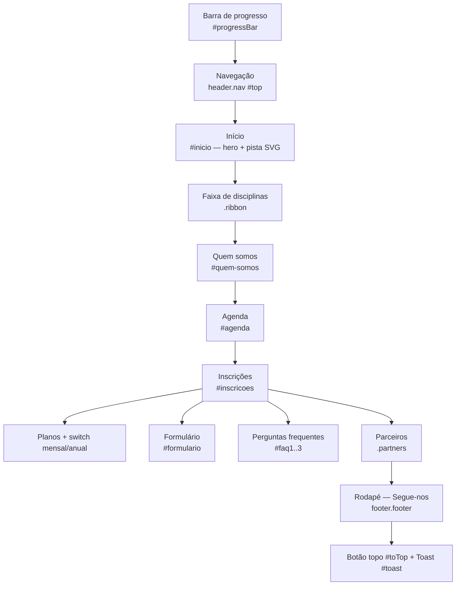

# Juventude Navegante

Site de página única (*one-page*) para uma escola de atletismo. Está escrito em português de Portugal e usa apenas HTML, CSS e JavaScript, sem frameworks nem passo de *build*.

> Para ver o site, basta abrir `index.html` no browser. Para o publicar, use o GitHub Pages: **Settings → Pages → Deploy from a branch → `main` / `(root)`**.

---

## 1. Estrutura de ficheiros

```
Juventude Navegante/
├── index.html   → estrutura e conteúdos (todo o texto do site)
├── styles.css   → design: cores, tipografia, layout, animações, responsivo
├── script.js    → interatividade: menu, agenda, inscrições, formulário
└── README.md    → este documento
```

Cada ficheiro tem uma responsabilidade:

| Camada | Ficheiro | Responsabilidade |
|---|---|---|
| Conteúdo | `index.html` | Secções, textos, planos, FAQ, rodapé |
| Apresentação | `styles.css` | Paleta, tipos de letra, componentes, *breakpoints* |
| Comportamento | `script.js` | Eventos, dados da agenda, validação |

---

## 2. Esquema geral da página



### Secções

| ID | Secção | Conteúdo |
|---|---|---|
| `#inicio` | Página inicial (*hero*) | Título, chamadas à ação, estatísticas com contador, pista de atletismo animada em SVG com cronómetro ao vivo |
| `#quem-somos` | Quem somos (Pista 01) | História do clube (expansível), valores e equipa técnica com biografias expansíveis |
| `#agenda` | Agenda (Pista 02) | Filtros por categoria, lista de eventos gerada em JS e horário semanal de treinos |
| `#inscricoes` | Inscrições (Pista 03) | Planos Rebentos / Sprint / Passada, formulário de inscrição e FAQ |

As ligações de navegação usam `href="#id"` com o atributo `data-scroll` para fazerem *scroll* suave até à secção.

---

## 3. Sistema de design (`styles.css`)

### Paleta de cores
Está definida em variáveis CSS no `:root`. Para mudar uma cor em todo o site, basta alterar a variável correspondente.

| Variável | Cor | Uso |
|---|---|---|
| `--orange` | `#FF6B1A` | Cor principal, botões e destaques |
| `--orange-deep` | `#E4501A` | *Hover* e sombras laranja |
| `--peach` | `#FFB27A` | Acentos suaves |
| `--blue` | `#1F4FD1` | Cor secundária, ligações e corredores da pista |
| `--navy` | `#0B1F44` | Fundos escuros (faixa, rodapé) |
| `--ink` | `#091634` | Texto principal |
| `--cream` | `#FFF6EC` | Fundo da página |
| `--sand` | `#F6E7D4` | Fundos de cartões e secções alternadas |
| `--muted` | `#5B6683` | Texto secundário |

### Tipografia (Google Fonts)
| Variável | Fonte | Uso |
|---|---|---|
| `--display` | Bricolage Grotesque | Títulos |
| `--body` | Manrope | Texto corrido |
| `--mono` | Space Mono | Números, cronómetro, etiquetas "Pista 0X" |

### Organização do CSS
O ficheiro está dividido por comentários, por esta ordem:
`variáveis` → `progress lane` → `buttons` → `nav` → `hero` → `ribbon` → `sections` (`about`, `agenda`, `join`) → `partners` → `footer` → `reveal` → `responsive`.

### Responsivo
| *Breakpoint* | Alteração |
|---|---|
| `≤ 1024px` | Ajustes de grelhas e tamanhos |
| `≤ 860px` | Menu móvel (botão hambúrguer) e colunas empilhadas |
| `≤ 520px` | Ajustes para telemóveis pequenos |
| `prefers-reduced-motion` | Desliga animações para quem as tem desativadas no sistema |

### Animações
- **Pista SVG:** 5 corredores animados com `animateMotion` (SMIL), inclinação 3D em CSS e flutuação suave.
- **Reveal:** os elementos com a classe `.reveal` aparecem ao entrar no ecrã (classe `.in`).
- **Contadores:** os números com `data-count` sobem de 0 até ao valor indicado.
- **Faixa (*ribbon*):** texto das disciplinas em movimento contínuo.
- **Acordeões:** abrem e fecham com transição em `grid-template-rows`.

---

## 4. Interatividade (`script.js`)

Todo o código está dentro de uma única função auto-executável (IIFE), dividida em blocos:

| Bloco | O que faz |
|---|---|
| `toast` | Mostra mensagens curtas no canto do ecrã (`toast("texto")`) |
| `nav & smooth scroll` | Menu móvel, *scroll* suave (`a[data-scroll]`), barra de progresso, botão "voltar ao topo" e destaque da secção ativa no menu |
| `reveal & counters` | Animações de entrada e contadores |
| `hero stopwatch` | Cronómetro ao vivo no formato `mm:ss,cc` |
| `generic toggles` | Abre e fecha qualquer painel ligado por `data-toggle="id"` |
| `agenda` | Lista de eventos, filtros, detalhes expansíveis e "Reservar lugar" |
| `billing` | Alterna os preços entre mensal e anual |
| `plan choice` | Os botões `data-choose` selecionam o plano no formulário |
| `form` | Valida o formulário e mostra a mensagem de sucesso |
| `social` | Os botões com `data-toast` mostram uma mensagem |

### Convenções de atributos `data-*`

| Atributo | Exemplo | Efeito |
|---|---|---|
| `data-scroll` | `<a href="#agenda" data-scroll>` | *Scroll* suave até à secção |
| `data-toggle` | `<button data-toggle="faq1">` | Abre/fecha o elemento `#faq1` (classe `.collapse`) |
| `data-count` | `<span data-count="120">` | Contador animado |
| `data-filter` | `<button data-filter="training">` | Filtra a agenda |
| `data-month` / `data-year` | `<span data-month="22" data-year="220">` | Preço mensal / anual |
| `data-choose` | `<button data-choose="Sprint">` | Escolhe o plano e salta para o formulário |
| `data-toast` | `<button data-toast="Mensagem">` | Mostra uma mensagem |

---

## 5. Como editar conteúdos

### Adicionar um evento à agenda
Os eventos ficam no *array* `events`, em `script.js`:

```js
{
  d: "09", m: "jan", wd: "sáb",        // dia, mês, dia da semana
  cat: "training",                      // training | competition | community
  title: "Nome do evento",
  time: "10:00",
  place: "Local",
  dist: "Distância ou escalão",
  text: "Descrição que aparece ao expandir o evento."
}
```

As categorias aparecem em português através do objeto `label` (`Treino`, `Competição`, `Comunidade`).

### Alterar preços dos planos
No `index.html`, dentro de cada cartão `.plan`, edite o texto e os atributos do preço:

```html
<span class="amt" data-month="22" data-year="220">22</span><span class="cur">€</span>
```

Se mudar o nome de um plano, atualize também o `data-choose` do botão e a `<option>` correspondente em `#planSelect`.

### Adicionar uma pergunta frequente
Copie um bloco existente e use um novo ID (por exemplo `faq4`) tanto no `data-toggle` do botão como no `id` do `.collapse`.

### Redes sociais
No rodapé, troque cada `<button class="social" data-toast="…">` por uma ligação real:

```html
<a class="social" href="https://instagram.com/…" target="_blank" rel="noopener">IG</a>
```

---

## 6. Formulário de inscrição

- **Campos obrigatórios:** nome, email (validado por expressão regular), plano e consentimento.
- **Quando é válido:** o formulário é ocultado e aparece o painel `#success`, com uma mensagem personalizada. O botão "Inscrever outro atleta" repõe o formulário.
- **Limitação:** os dados **não são enviados** para nenhum servidor, porque o site é estático. Para receber inscrições reais, ligue o `<form>` a um serviço como Formspree, Google Forms ou um backend próprio.

---

## 7. Acessibilidade

- `lang="pt-PT"` no documento.
- Atributos `aria-expanded`, `aria-controls`, `aria-label` e `role` nos botões interativos.
- Foco visível (`:focus-visible`) com contorno laranja.
- O menu móvel fecha com a tecla **Esc**.
- As animações respeitam `prefers-reduced-motion`.
